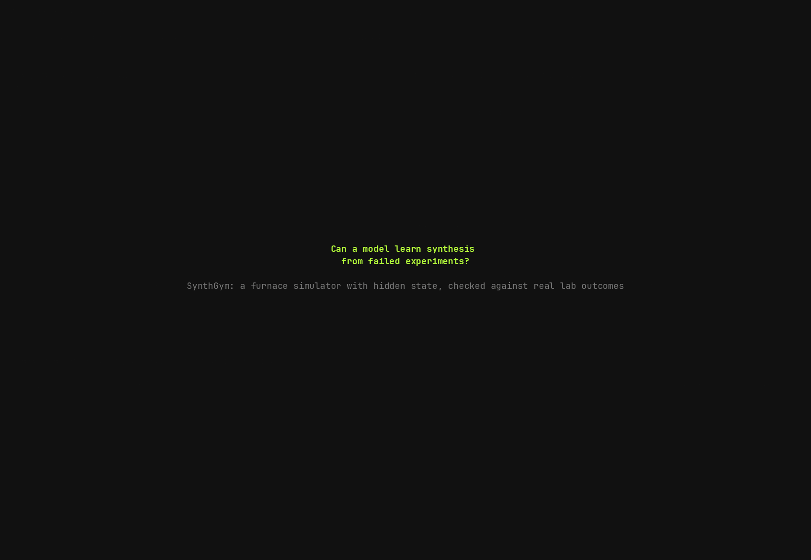
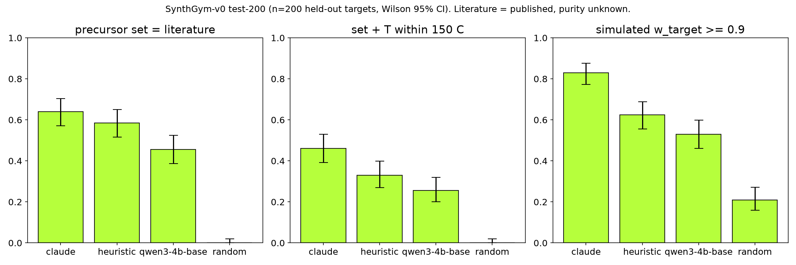

# Synthesis Gym

Synthesis Gym is a reinforcement-learning environment for making inorganic materials by solid-state
synthesis. The agent puts precursor powders in a crucible, heats them, regrinds them, pays for an XRD
scan, and decides when to stop. It never sees inside the crucible. The simulator tracks which phases
are really there, and the agent only gets the noisy XRD scans it pays for.

Order matters, the same way it does in a real lab. A phase that forms early can use up the energy
the target reaction needed, and powder that has sintered reacts slowly until someone regrinds it.

We check the simulator against real synthesis results, failed runs included, from ARROWS3 and A-Lab.
A real furnace can plug into the same backend interface the simulator uses.

## Demo video



The full 74-second film is [results/video/film.mp4](results/video/film.mp4). It shows SmolLM3-3B on
Eu2Ir2O7, a target it never trained on. Before training, the model's own XRD shows 87% target, but it
keeps heating up to 1500 C and destroys the phase. After GRPO, the same model heats once at the
published 1000 C, checks the XRD, stops, and ends at 100% target.

An earlier demo of Claude running one episode is
[results/video/demo.mp4](results/video/demo.mp4).

## Benchmarks

We test on SynthGym-v0/test-200, which has 200 targets from chemical systems that never appear in
training. The language models call the gym's tools one step at a time, see each result before the
next call, and decode greedily.

| agent | simulated success (w >= 0.9) | recipe match vs literature | mean return |
|---|---|---|---|
| Claude Opus 5.5 | 83% | 46% | 1.17 |
| SmolLM3-3B + GRPO | 76% | 22.5% | 1.03 |
| Qwen3-4B-Instruct + GRPO (60 steps) | 76.5% | 33% | 1.03 |
| Qwen3-4B-Instruct base | 74.5% | 27.5% | 0.98 |
| Qwen3-4B-Instruct clean-only (RFT) | 73.5% | 25% | 0.95 |
| heuristic (most common precursors, Tammann T) | 62% | 33% | 0.95 |
| SmolLM3-3B base | 8% | 5.5% | 0.12 |
| random | 21% | 0% | 0.49 |

- GRPO takes SmolLM3-3B from 8% to 76% simulated success (exact McNemar p = 2e-41).
- A model that learns from its failures beats one trained only on its successes. On Qwen3-4B, GRPO
  gets 33% recipe match and the clean-only model gets 25% (p = 0.005).
- Recipe match compares the model's recipe with the published one. It never reads the simulator.



The full tables, confidence intervals and tests are further down.

## Run

```sh
uv sync
uv run python scripts/fit_kinetics.py          # fits the extent law on ARROWS3 (writes models/kinetics.json)
uv run python scripts/run_eval.py random heuristic claude
uv run python scripts/demo.py --task SynthGym-v0/hard/BaFe12O19 --agent claude
./scripts/record_demo.sh                        # results/video/demo.{cast,gif,mp4}
```

Claude runs on AWS Bedrock (`us.anthropic.claude-opus-5-5`, us-east-1, profile `default`), and its
replies are cached in `cache/claude/`. Raw data goes in `data/raw/`. The sources are listed at the end.

## How the simulator works

- **State.** The simulator stores the moles of each phase, the mass lost as gas, and a contact
  factor. Each heat halves the contact factor and a regrind resets it. The code is in
  `synthgym/sim.py`.
- **Reactions.** For each phase and each pair of phases, a linear program finds the products with
  the lowest Gibbs energy among the Materials Project phases (matminer `mp_nostruct_20181018`, 0 K
  formation energies). Gases leave with an entropy term. Oxygen moves between the sample and the
  atmosphere, and the atmosphere's oxygen pressure (air, O2, inert, vacuum or reducing) sets its
  chemical potential. We don't write rules for carbonate decomposition, for reaction with an acidic
  oxide below the carbonate's own decomposition temperature, or for reduction under H2. All three
  come out of the same minimisation.
- **Kinetics.** The reacted fraction is `x = 1 - exp(-t * contact / tau)`, with
  `tau = tau0 * exp(-beta (T/T_on - 1)) * exp(gamma dG)` and `T_on = alpha * min(Tm)`. We fit the four
  constants to ARROWS3 phase fractions (`synthgym/kinetics.py`, `scripts/fit_kinetics.py`).
- **Reward.** The reward is the target's true weight fraction when the agent stops, plus 0.5 if that
  fraction is at least 0.9, minus capped process costs.

## Results on test-200

| agent | precursor set = literature | set + T within 150 C | T MAE (C) | simulated w >= 0.9 | mean return |
|---|---|---|---|---|---|
| Claude Opus 5.5 (closed loop) | 64% [57, 70] | 46% [39, 53] | 139 | 83% [77, 88] | 1.17 |
| heuristic (most common precursors, Tammann T) | 58% [52, 65] | 33% [27, 40] | 202 | 62% [56, 69] | 0.95 |
| Qwen3-4B-Instruct base (plan mode) | 46% [39, 52] | 26% [20, 32] | 212 | 53% [46, 60] | 0.89 |
| random | 0% | 0% | 477 | 21% [16, 27] | 0.49 |

Brackets are Wilson 95% intervals with n = 200. Always guessing the median temperature gives a
temperature MAE of 244 C. Claude beats the heuristic on recipe match (exact McNemar p = 0.001) and on
simulated success (p = 2e-10). The precursor match difference is not significant (p = 0.09). The
literature columns never read the simulator. "Literature" means the published recipe, and we don't
know how pure the published product was.

We also scored the simulator against real outcomes it was not fit on (`results/kinetics_fit.json`).
For YBCO precursor sets, the predicted target fraction separates runs that reached at least 50 wt%
target from runs that didn't with an AUC of 0.79 (n = 72). Within the 900 C runs alone the AUC is
0.62 (n = 18). On NTMO, which we never fit, it is 0.30. The simulator gets the temperature trend
right and most of the phase-level detail wrong (mean L1 error 1.36 out of a possible 2).

## Training open models in the gym

Models act through five tools, `add_precursors`, `heat`, `regrind`, `xrd` and `stop`, and see each
result, including the XRD they paid for, before the next call (`synthgym/tool_env.py`). We train
with TRL GRPO and its `environment_factory`, LoRA r=16, fp16 on T4 GPUs, for 30 steps of 4 prompts
with 8 rollouts each, on the training split (`scripts/train_grpo_tools.py`). We evaluate greedily on
the same 200 held-out targets with vLLM (`scripts/eval_tools.py`) and compare each model with itself
before training using paired tests.

| model (closed loop, n = 200) | precursor match | recipe match | simulated w >= 0.9 | mean return |
|---|---|---|---|---|
| SmolLM3-3B base | 10.5% | 5.5% | 8% [5, 13] | 0.12 |
| SmolLM3-3B + GRPO | 43.5% | 22.5% | 76% [70, 81] | 1.03 |
| Qwen3-4B-Instruct base | 55.5% | 27.5% | 74.5% [68, 80] | 0.98 |
| Qwen3-4B-Instruct + GRPO | 56.5% | 27% | 76% [70, 81] | 1.03 |

SmolLM3 improves on every metric. The exact McNemar p-values are 3e-20 for precursor match, 2e-8 for
recipe match and 2e-41 for simulated success. Part of the gain is that the model learns to call the
tools correctly at all. Format errors drop from 2.64 to 0.05 per episode. Precursor match against
the literature, which never reads the simulator, goes up too.

Qwen3-4B changes how it works. It runs more XRD scans and regrinds more, and its temperature error
against the literature falls from 301 C to 222 C. Its outcomes don't change by a significant amount
(simulated success p = 0.68).

### Training on clean data only vs learning from failures

Both arms start from the same Qwen3-4B base and use the same rollout budget.

- **Clean-only (rejection-sampling fine-tuning).** We sampled 931 base-model episodes on the
  training split, kept the 641 that reached the target and threw away the 290 failures. This is
  what training on published recipes does, because papers only publish what worked. We trained a
  LoRA with SFT for one epoch (`scripts/train_rft.py`).
- **GRPO.** GRPO learns from both the successes and the failures. We ran 60 steps, 30 and then 30
  more starting from the step-30 adapter (`--init-adapter`).

| arm (n = 200 held-out) | simulated success | recipe match | mean return |
|---|---|---|---|
| base | 74.5% | 27.5% | 0.98 |
| clean-only (RFT) | 73.5% | 25.0% | 0.95 |
| GRPO, 60 steps | 76.5% | 33.0% | 1.03 |

GRPO beats clean-only on recipe match (exact McNemar p = 0.005) and on return (Wilcoxon p = 0.046).
The simulated success difference is not significant (p = 0.18). Clean-only is no better than the
base model on any metric. We ran several tests, so p = 0.046 is borderline. Recipe match is scored
against the literature, not the simulator.

These runs also exposed a gap in the simulator. Both models pick an inert atmosphere for almost
every heat, and nothing in the simulator punishes that. Published recipes even reach slightly more
target under inert gas than under air in the simulator, though 175 of the 200 use air. We need real
furnace runs to calibrate the oxygen-pressure effects.

## Data sources

- Ceder group text-mined solid-state recipes, Kononova et al., Sci. Data 2019, release 2020-07-13
  (github.com/CederGroupHub/text-mined-synthesis_public). That repo has no licence file.
- ARROWS3, Szymanski et al., Nat. Commun. 2023 (github.com/njszym/ARROWS, Examples/*/Exp.json).
- A-Lab, Szymanski et al., Nature 2023, SI `41586_2023_6734_MOESM3_ESM.zip`.
- Materials Project formation energies, through matminer `mp_nostruct_20181018`.

The design history is in `docs/brief.md`, `docs/SPEC.md`, `docs/debate/`, `docs/arch/` and
`docs/ARCHITECTURE.md`.
